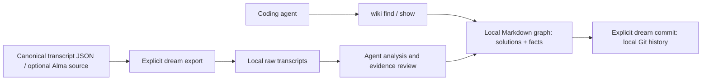

# bugwiki

A local Markdown knowledge graph for coding agents. Keep costly bug fixes and
sourced facts in one searchable store, with typed links, validity dates, and a
transcript-to-fact workflow called the **dream**.

A solution records the exact symptom, cause, fix, failed attempts, and verification.
A fact records something now true, its source, and when it stops being current.
Your agent searches before debugging or acting on remembered state, so the next
session can reuse the evidence and avoid repeating the work.

No database, daemon, or embeddings service. Files stay local; `ripgrep` handles
retrieval. The core accepts canonical transcript JSON from any host, with an
optional explicit Alma adapter. For DeepSeek Harness, use the separate
[dsh-bugwiki plugin](https://github.com/phillui-37/dsh-bugwiki).

[Install](#install) · [Usage](#usage) · [DSH integration](#deepseek-harness-dsh) ·
[Dream export](#facts-edges-and-the-dream) · [Protocol](PROTOCOL.md) ·
[Sync setup](CHEZMOI.md)

## How it works

Keep the package (code and templates) separate from the content store (knowledge
and local Git history). An agent searches the store, reads matching pages, and
checks their status and supersession chain before using them.



Loading the skill or installing the helper starts no background maintenance.
`dream export` renders transcripts without invoking a model. Analysis is a separate
agent step; `dream commit` records content changes. Neither scheduling nor
promotion into global agent instructions is automatic. See the
[read, write, and dream protocol](PROTOCOL.md) for the evidence rules and boundaries.

## Why

An agent that spends 40 minutes on a provider 429 learns something valuable and
then forgets it, because the lesson lives in a chat log that scrolls away. The
next session pays the same 40 minutes again.

Memory files do not fix this: they hold conclusions, not the reproduction. When
the conclusion is "check the key's product line", the agent still lacks the
symptom to match on and the failed attempts to avoid.

## What it looks like

```text
~/.agents/wiki/
  README.md                      router + index
  LESSONS.md                     rules that repeated (empty is a valid state)
  solutions/<domain>/<slug>.md   one bug per file
  templates/entry.md
  facts/<slug>.md                sourced facts and their validity
  .raw/                          local transcript exports (gitignored)
  .dream/                        export checkpoints (gitignored)
  reports/<date>.md              daily housekeeping report
  archive/<domain>/              obsolete pages, out of circulation, still on disk
  .git/                          local content history; no remote required
```

A page:

```markdown
---
title: Z.ai Coding Plan key returns 429 for every model
status: workaround
recurrence: 1
env: macOS 27.2 arm64, provider zai-coding-plan
last_seen: 2026-11-02
last_verified: 2026-11-02
oneliner: A 429 from a provider with separate key families can be an entitlement
  answer rather than a rate limit; check which product line minted the key.
---

## Symptom
Paste the exact error text — search is textual.

## Cause
What you actually confirmed. Mark a guess as a guess.

## Fix
The commands that worked, in order.

## Failed attempts
What you tried and why it could not work. This is the expensive part to rediscover.

## Verify
A command that shows output which changes. Printing a constant proves nothing.
```

## Install

Keep two directories: **PKG** is this repository (code and templates); **WIKI_HOME**
is a separate, machine-local content store. Update PKG with Git or your skill
manager. Give WIKI_HOME its own local Git history; do not push knowledge or raw
transcripts to this public repository. See [sync setup](CHEZMOI.md).

### Platform support

| Feature | macOS (Bash) | Native Windows (PowerShell 5.1 / 7+) |
| --- | --- | --- |
| Solution pages: `init`, `find`, `list`, `new`, `index`, `lint`, `housekeep` | Available | Available |
| Fact graph: `new fact`, `show`, `stale`, `verify` | Available | Not implemented |
| Transcript export and `dream` | Available | Not implemented |

The file format can be shared, but the command surfaces differ. The native Windows
helper covers solution pages only; do not interpret `wiki new fact` there as the
Bash fact command. The Bash helper uses BSD `date -j -f` for date validation,
staleness and archive ages. GNU/Linux (including WSL) is not fully supported: those
commands need a compatible date utility and have not been validated there. The
commands below are verified on macOS; do not infer Linux support from Bash alone.

### macOS (Bash)

Prerequisites: Git, Bash, ripgrep (`rg`), and Python 3.10+ for transcript export and
the regression suite. On macOS, `brew install git ripgrep python` provides the
non-system dependencies. Linux users must resolve the date limitation above
before relying on verification, staleness or archive behavior.

Run this once for a **new** store (choose unused directories):

```sh
# Code and content must be different directories.
export BUGWIKI_PKG="$HOME/.local/share/bugwiki"
export WIKI_HOME="$HOME/.agents/wiki"
mkdir -p "$(dirname "$BUGWIKI_PKG")" "$HOME/.local/bin"
git clone https://github.com/phillui-37/bugwiki "$BUGWIKI_PKG"
bash "$BUGWIKI_PKG/scripts/wiki" init "$WIKI_HOME"
ln -sf "$BUGWIKI_PKG/scripts/wiki" "$HOME/.local/bin/wiki"
export PATH="$HOME/.local/bin:$PATH"
git -C "$WIKI_HOME" init
wiki verify --migration
wiki list
```

`init` prints the content root and the real `scripts/wiki` entrypoint without
missing-file errors. `verify --migration` must exit 0; `list` is empty in a new
store. Configure Git's `user.name` and `user.email` for the content repository
before the first `wiki dream commit` if they are not already configured.
Persist PATH and, for a non-default store, WIKI_HOME in your shell startup file.
`init` uses WIKI_HOME when no target is passed and refuses an existing populated
content store. Do not rerun it as an upgrade step.

### Native Windows — solution pages only

Prerequisites: Git and PowerShell 5.1 or 7+. Ripgrep is optional here; the helper
falls back to `Select-String`.

```powershell
$env:BUGWIKI_PKG = Join-Path $HOME '.local/share/bugwiki'
$env:WIKI_HOME = Join-Path $HOME '.agents/wiki'
New-Item -ItemType Directory -Force (Split-Path $env:BUGWIKI_PKG) | Out-Null
git clone https://github.com/phillui-37/bugwiki $env:BUGWIKI_PKG
powershell -NoProfile -ExecutionPolicy Bypass -File "$env:BUGWIKI_PKG/scripts/wiki.ps1" init $env:WIKI_HOME
$env:Path = "$env:BUGWIKI_PKG/scripts;$env:Path"
wiki.cmd list
```

Persist that scripts directory in PATH, and WIKI_HOME if you use a non-default
store. The empty store lists no pages. Use the package's `scripts/wiki.cmd` so
package updates take effect; the older copies seeded in the store's `bin/` are
not the recommended PATH target. Graph and dream commands are unavailable in
this native helper.

### Agent integration and existing installations

Append [assets/AGENTS-block.md](assets/AGENTS-block.md) to the instruction file
your host reads. For native Windows, use only its solution search/write policy;
omit Bash-only graph verification and dream instructions. No scheduler is
installed automatically. Schedule housekeeping or an agent's dream pass only
when you want those tasks to run.

Hosts that scan skill directories can install this repo as a skill (`SKILL.md`
is at the root). Set BUGWIKI_PKG to that installed directory and follow the
separate-store setup, skipping the clone.

Legacy clone-as-store installations remain readable, with their index in
`INDEX.md`. They are not the supported dream setup: the package ignores
`solutions/` and `reports/`, which conflicts with versioning content and dream
reports. Keep the existing store intact; prepare and verify a separate content
repository before switching WIKI_HOME. Do not remove ignore rules or force-add
private knowledge to the public package checkout.

### DeepSeek Harness (DSH)

[dsh-bugwiki](https://github.com/phillui-37/dsh-bugwiki) is a separate DSH plugin
with a web settings client. It vendors a pinned revision of this repository as
an unchanged `upstream/` submodule; plugin-specific tools, settings, and guidance
live in the adapter. Updating this repository alone does not update that pin.

Install it using the plugin's
[installation instructions](https://github.com/phillui-37/dsh-bugwiki#requirements-and-installation),
then select the content directory with `wikiHome` in **Plugins → Bugwiki → Settings**.
Reuse an existing store, or initialize a new one with the adapter's maintenance CLI.
The plugin currently targets macOS and DSH `>=0.2 <0.3`; use its documentation for
current runtime requirements and configuration.

- The `bugwiki` tool exposes `find`, `show`, `read`, `list`, `lint`, `verify`, and
  `stale`. Graph writes use the host's ordinary file tools; maintenance is explicit.
- When both DSH session services are available, `bugwiki_export_dream` exports
  explicitly selected sessions through the bundled upstream Python exporter.
  `dryRun` defaults to `true`; writing requires `dryRun: false`.
- DSH session conversion belongs to the adapter. The core does not read DSH
  sessions directly. The plugin includes no scheduled tasks, auto-commit, or
  auto-publication.

The plugin can optionally follow a matching installed upstream `SKILL.md` using
`followUpstreamSkill`. See its
[agent interface](https://github.com/phillui-37/dsh-bugwiki#agent-interface) and
[maintenance guide](https://github.com/phillui-37/dsh-bugwiki#human-maintenance)
for its tool contract, export limits, and review requirements.

## Usage

| Command | Does |
| --- | --- |
| `wiki find "429 Too Many Requests"` | literal search; `WIKI_REGEX=1` for a regex |
| `wiki list` | every page as `domain/slug` |
| `wiki new editor config-loss` | new page from the template, reindexes |
| `wiki index` | regenerate the content README index table |
| `wiki lint` | bad fields, stale pages, promotion candidates; exits 1 on errors |
| `wiki housekeep [--apply]` | archive queue, promotions, duplicate pairs → `reports/<date>.md` |
| `wiki init [target]` | scaffold a new store from the bundled assets |

On Windows the same commands exist as `wiki.cmd` (calls `wiki.ps1` with `pwsh`
when installed, `powershell` otherwise). `WIKI_REGEX=1` works there too —
`$env:WIKI_REGEX=1`.

## Write gates

**New solution: gated on cost.** 30+ minutes on the fix, or 3+ failed attempts, or the
error text does not explain the cause. A typo or a missing dependency the error
already named gets no page. Cheap entries turn search into noise.

**New fact: gated on evidence.** A `facts/<slug>.md` page needs a `source:` that
identifies the real thread/message. Use `verified` only when the claim traces to
a tool result; prose-only support remains `open`. Record validity and expiry
where needed, and supersede changed facts instead of deleting their history.
See [the write protocol](PROTOCOL.md#write-protocol).

**Recurrence bump: never gated.** If a page answered your search, bump
`recurrence:` before you move on. A wiki hit is cheap by definition, so gating the
bump would starve the only counter the ladder uses.

## Promotion ladder

| Occurrence | Where it lives |
| --- | --- |
| 1st, costly | `solutions/<domain>/<slug>.md` |
| 2nd | one line in `LESSONS.md` |
| 3rd | a standing rule in your agents instruction file |

`recurrence:` is a number on the page, not a judgement. Housekeeping names pages at
2; you decide when a rule is general enough for 3. Writing a second page for the
same bug resets the counter to 1 — search first.

## Housekeeping

When you schedule or run `wiki housekeep --apply`, it reindexes and moves pages whose
`obsolete_since` is older than 90 days into `archive/`. It never deletes a page and
never overwrites an archived file; a collision is reported instead.

The report lists what needs a human: pages at `recurrence: >= 2`, pages whose
`last_verified` is older than 180 days (the fix may have rotted with the tool), and
possible duplicates by `oneliner` token overlap.

Thresholds are env-overridable: `WIKI_STALE_DAYS`, `WIKI_ARCHIVE_DAYS`,
`WIKI_LESSONS_MAX`, `WIKI_DUP_JACCARD`, `WIKI_DUP_MIN_PAGES`, `WIKI_REPORTS_KEEP`.

## Prior art and how this differs

| Project | What it does | Difference |
| --- | --- | --- |
| [yetone/magpie](https://github.com/yetone/magpie) | `LESSONS.md` written by a nightly commit review, promoted at 3 review days into `docs/code-standards.md` | Solution capture is gated on debugging cost; the optional dream analyzes transcripts rather than commits, and rule promotion remains a separate decision |
| [compound-engineering](https://github.com/EveryInc/compound-engineering-plugin) `ce-compound` | captures solved problems under `docs/solutions/` in a repo | This is machine-wide (`~/.agents/`), not per-repo, and spans tools rather than one codebase |
| `CLAUDE.md` / `AGENTS.md` memory | rules and conclusions | A rule without the symptom does not match; a symptom without failed attempts gets re-tried |

The parts borrowed from magpie are named; the parts invented here are the cost
gate, the second-occurrence bar, and the `recurrence:` counter.

## Design notes

- **Two helpers, one contract.** `scripts/wiki` (bash) and `scripts/wiki.ps1`
  share the solution-page format and older command contract. Graph and dream
  commands are Bash-only; see the platform matrix above. The PowerShell port uses `rg` when it exists and
  falls back to `Select-String`, because Windows machines often lack ripgrep.
- **bash + ripgrep.** Retrieval is `rg -F` over a few dozen files. At 3 pages this
  is enough; at 500 it is still fast, and the failure mode (a paraphrase the
  keywords miss) is visible in the search output rather than hidden in a ranking.
- **`oneliner:` is the join key.** The second occurrence usually arrives in
  different words, so the reusable sentence is what catches it — `wiki find`
  prints it first.
- **`last_seen` and `last_verified` are separate.** Recurrence and validity decay
  at different speeds.
- **Nothing is deleted.** Obsolete pages move to `archive/`; reports keep the
  newest 30.

## License

MIT.

## Facts, edges and the dream

The wiki holds two kinds of node in one namespace: `solutions/<domain>/<slug>.md`
(a bug that cost real time) and `facts/<slug>.md` (something now true, with a
`source:`). `kind` is derived from the path, so pages written before the schema
need no edit.

```bash
wiki show <slug>        # kind, validity, inbound edges, supersession chain
wiki stale              # expired, or past the per-kind limit
wiki verify             # schema, dates, every edge resolves
wiki dream export --input threads.json # publish a manifest-backed immutable batch
wiki dream begin --batch .raw/<date>/<batch-id>
wiki dream progress                    # resume the active manifest
wiki dream resolve --thread PATH --gaps 'reviewed evidence reference'
wiki dream commit       # verify, report, commit, and write a receipt
```

`dream export` needs an explicit source. Generic callers use this canonical JSON shape (unknown fields may be omitted; each thread must have an `id`, `messages` array, and, for automatic selection, a timezone-aware `updatedAt`):

```json
{
  "threads": [{
    "id": "thread-123",
    "title": "Example conversation",
    "updatedAt": "2026-11-09T12:00:00+02:00",
    "messages": [{
      "id": "message-456",
      "role": "user",
      "timestamp": "2026-11-09T10:15:00+02:00",
      "timezone": "Europe/Paris",
      "content": "Hello"
    }, {
      "id": "message-789",
      "role": "assistant",
      "content": [
        {"type": "text", "text": "Hi."},
        {"type": "tool_call", "name": "Bash", "input": {"cmd": "pwd"}},
        {"type": "tool_result", "name": "Bash", "output": "/workspace"}
      ]
    }]
  }]
}
```

`threads` is the feed; thread `id` is a safe filename key and `title` is display text. `updatedAt` is the thread event/update time used by `--since` filtering and must include an explicit UTC offset. Message `id` identifies the message. `timestamp` is the original sent-at value, kept with its supplied offset; it may differ from the thread event time. `timezone` is optional source timezone metadata (for example an IANA zone) and is preserved separately. Message `role` is `user`, `assistant`, or `tool`; `content` is text or an ordered array of text, tool call, and tool result parts. A tool-only message still gets its message header.

The Alma adapter requires `--source alma`; it captures a UTC `selected_at` upper bound before fetching, stores the lower `since` cutoff separately, and filters listed threads by that lower bound before fetching messages. Only a complete successful Alma batch advances its checkpoint to the captured upper bound. Forced `--thread` exports set `advances_watermark: false`; generic `--input` never changes a watermark. Automatic Alma runs overlap the prior checkpoint by 30 minutes. A pending or partial run must be resumed before another export. `--since` supplies an explicit cutoff. Keep distinct feeds in separate `WIKI_HOME` roots: generic thread IDs are only unique inside their feed, and separate roots prevent collisions. Export renders transcripts only and does not invoke a model. Existing Alma workflows add `--source alma`. The legacy `.dream/last-run` is shown by `dream status` but is not used by the new exporter; the first run uses the default seven-day window unless you provide `--since`. Date-only cutoffs use UTC. The optional Alma adapter lists up to 200 threads and fails if a selected thread still has more messages at the 2,000-message pagination limit.

The new workflow requires manifest-backed `.raw` batches. Installing the package source files alone does not migrate existing flat `.raw` batches, and those batches cannot be started with the new `begin` command. Preserve the current recovery batch and finish it with its original workflow before upgrading; there is no automatic migration of that recovery state.

A changed fact is never deleted: the old node gets `valid_to` + `status:
obsolete`, the new one gets `supersedes: [old-slug]`. [PROTOCOL.md](PROTOCOL.md) defines the current schema, thresholds and agent
policy; [CHEZMOI.md](CHEZMOI.md) explains the sync split (code syncs, content does not).

Resumable dream processing, explicit acknowledgements and manifest-scoped commits are documented in [docs/dream-recovery.md](docs/dream-recovery.md). Exported transcripts are frozen and export alone does not count as successful processing.

`tests/run.sh` is the offline regression suite (no network or live Alma calls).
